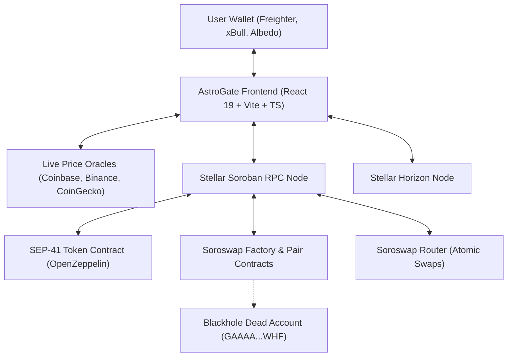

# AstroGate 🌊🚀 — Stellar Fair Launchpad & AMM

AstroGate is a decentralized, zero-backend Fair Launchpad and automated market maker (AMM) built natively on Stellar/Soroban. It introduces fair, anti-rug memecoin launch mechanics to the Stellar ecosystem:

- **Zero Protocol Deploy Fee**: Deploy a fair launch for only your XLM seed liquidity + standard Stellar network gas (~0.05 XLM).
- **0.5% Creator · 99.5% Pool Allocation**: 5M tokens immediate to creator; 995M tokens seeded directly into the Soroswap AMM pair (`launch_fair`).
- **Mandatory Anti-Rug LP Burn & On-Chain Registry**: 100% of initial LP tokens are irrevocably transferred on launch to Stellar's canonical dead address (`GAAAAAAAAAAAAAAAAAAAAAAAAAAAAAAAAAAAAAAAAAAAAAAAAAAAAWHF`) and recorded in the Launchpad v2 registry (`get_launches`, `get_launch`).
- **Permanent Mint Freezing & On-Chain Burn-to-Chat**: Contract ownership is renounced immediately on launch (`renounce_ownership`), token supply is sealed via OpenZeppelin `Capped`, and traders can burn tokens on-chain to post live shouts (`burn_shout`, `get_shouts`).
- **Real-Time Live Pricing & 0ms Quotes**: Multi-source XLM oracle waterfall combined with instant deterministic `997/1000` constant-product AMM math and RPC failover across testnet nodes. Zero mock data.
- **Zero-Backend Architecture**: Identity = non-custodial wallet (`@creit.tech/stellar-wallets-kit`) or 1-click Testnet Demo keypair. Data = Stellar Horizon + Soroban RPC.

---

## Architecture Overview



---

## Live Contracts & Testnet Deployment

| Component | Testnet Contract / Address |
| :--- | :--- |
| **RPC Endpoint** | `https://soroban-testnet.stellar.org` |
| **Horizon Endpoint** | `https://horizon-testnet.stellar.org` |
| **Flagship Token ($ASTRO)** | `CAI637WCEILQF3ZYOV6BRUCX532XQIVOOJ4CRWFPWHQRJHOH5OKHSXRE` |
| **Token WASM Bytecode Hash** | `a47dc064f7a072476fbbd612be98ce13d691b178b81a40ebdf4b2ec78f65c9f7` |
| **Atomic Launchpad Contract (v2)** | `CB5LMSJ2Y2KEZEO2BXTRNA2OPFALVU6AVIOASVPZTQ66GRT3UEKOQ3O4` |
| **Launchpad WASM Bytecode Hash (v2)** | `379575a09e323cd3244780ac7f2441a38cb85cd34ebcce84736802e081956125` |
| **Soroswap Factory** | `CDP3HMUH6SMS3S7NPGNDJLULCOXXEPSHY4JKUKMBNQMATHDHWXRRJTBY` |
| **Soroswap Router** | `CCJUD55AG6W5HAI5LRVNKAE5WDP5XGZBUDS5WNTIVDU7O264UZZE7BRD` |
| **XLM SAC (Stellar Asset Contract)** | `CDLZFC3SYJYDZT7K67VZ75HPJVIEUVNIXF47ZG2FB2RMQQVU2HHGCYSC` |
| **Anti-Rug Burn Address** | `GAAAAAAAAAAAAAAAAAAAAAAAAAAAAAAAAAAAAAAAAAAAAAAAAAAAAWHF` |

---

## Key Features

1. **Fair Launch Form (`/create`)**:
   - Minimalist launchpad (`launch_fair`): Name, Ticker, Seed XLM, live SVG preview, and optional collapsed off-chain links encoded in on-chain `meta` (`≤ 512` bytes).
   - Fixed 1B supply (7 decimals): seeds 995M tokens (99.5%) + seed XLM directly into Soroswap, sends 5M (0.5%) to creator, burns 100% LP to `GAAAA...WHF`, and renounces mint authority atomically in one transaction.
2. **Instant AMM Trading, Burn-to-Chat & Audit (`/token/:id`)**:
   - Buy/sell against Soroswap pools with instant local `997/1000` quotes (0ms lag) and dynamic price-impact / slippage guards.
   - Real on-chain Burn-to-Chat (`burn_shout` + `get_shouts`), live ledger activity feed, and dedicated **Audit & Contract** tab with 90-day TTL refresh (`extendTokenTtl`).
3. **Live Pump-Style Market Feed (`/`, `/market`)**:
   - Discovers tokens directly from the Launchpad v2 on-chain registry (`get_launches`) merged with Soroswap factory events (no external DB needed).
   - Features King of the Hill spotlight, Fair Launchpad verified filter (`✓ Fair`), instant search, and watchlist.
4. **Local Portfolio & Data Export (`/portfolio`)**:
   - View created tokens, user holdings, and local transaction activity.
   - Export full transaction history as CSV or JSON for personal records / auditing.
5. **1-Click Testnet Demo Wallet**:
   - Click `Testnet Demo` directly in the top wallet menu to generate and Friendbot-fund a disposable testnet account in one click.

---

## Local Development & Quick Start

```bash
# Clone repository
git clone https://github.com/ruwaq/astro-launchpad.git
cd astro-launchpad
git checkout main

# Install dependencies and start dev server
cd frontend
npm ci
npm run dev # http://localhost:5173
```

### Verification & Testing Gates

```bash
# Run full frontend quality gate (build + lint + tests + smoke SSR + PWA audit + CSP parity)
npm run check

# Run smart contract unit tests
cargo test -p astro-token
cargo test -p astro-launchpad-contract

# Run smart contract linter
cargo clippy -p astro-token --all-targets -- -D warnings

# Read-only live on-chain testnet verification (zero secret needed)
npm run verify:discovery     # Real pair discovery from Soroswap factory
npm run verify:demo          # 3 new Friendbot accounts + complete lifecycle flow
```

---

## Production Deployment

### Cloudflare Workers / Pages
Defined in `frontend/wrangler.jsonc` with static assets:
```bash
cd frontend
npm run build
npm run deploy # npx wrangler deploy
```

### Vercel Deployment
Pre-configured in `frontend/vercel.json` with strict Content-Security-Policy (CSP), HSTS, and cache headers:
```bash
vercel --prod
```

---

## Security Status

- **Verified via automated gates**: frontend strict typecheck, unit tests, lint, SSR smoke, PWA audit and CSP parity run on every `npm run check`; contract tests run with `cargo test`. No third-party security audit has been performed yet — do not rely on this repository as audited.
- **Smart Contracts**: built on audited OpenZeppelin Stellar components (`stellar-tokens 0.8.0`).
- **Anti-Rug Guarantee**: mathematically irrevocable LP lock to canonical dead address.
- **Content Security Policy**: strict headers applied across all deployment targets (parity enforced by `npm run check:csp`).
