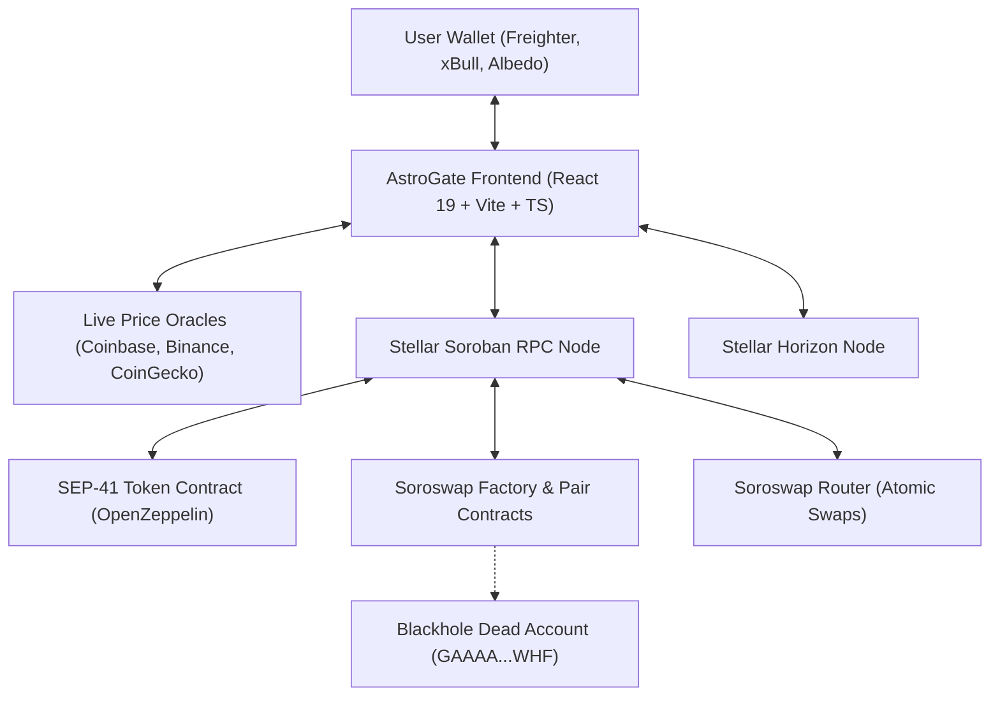

# AstroGate 🌊🚀 — Stellar Fair Launchpad & AMM

AstroGate is a decentralized, zero-backend Fair Launchpad and automated market maker (AMM) built natively on Stellar/Soroban. It introduces fair, anti-rug memecoin launch mechanics to the Stellar ecosystem:

- **$1.11 USD Fixed Launch Fee**: Mint fair tokens with low fees pegged via live multi-source price oracles.
- **0.5% Creator · 99.5% Pool Allocation**: 5M tokens max to the creator (vested after graduation); 995M tokens seeded directly into the Soroswap AMM pair.
- **Mandatory Anti-Rug LP Burn**: 100% of initial LP tokens are irrevocably transferred on launch to Stellar's canonical dead address (`GAAAAAAAAAAAAAAAAAAAAAAAAAAAAAAAAAAAAAAAAAAAAAAAAAAAAWHF`). Initial pool liquidity cannot be drained.
- **Permanent Mint Freezing**: Contract ownership is renounced immediately on launch (`renounce_ownership`), disabling all future minting.
- **Real-Time Live Pricing**: Multi-source oracle waterfall (Coinbase, Binance, CoinGecko) combined with real-time on-chain Soroswap AMM reserve calculations. Zero mock data.
- **Zero-Backend Architecture**: Identity = non-custodial wallet (`@creit.tech/stellar-wallets-kit`). Data = Stellar Horizon + Soroban RPC.

---

## Architecture Overview



---

## Live Contracts & Testnet Deployment

| Component | Testnet Contract / Address |
| :--- | :--- |
| **RPC Endpoint** | `https://soroban-testnet.stellar.org` |
| **Horizon Endpoint** | `https://horizon-testnet.stellar.org` |
| **Flagship Token ($ASTRO)** | `CAI637WCEILQF3ZYOV6BRUCX532XQIVOOJ4CRWFPWHQRJHOH5OKHSXRE` |
| **Token WASM Bytecode Hash** | `5930d6c69894f5cd6924e1a7d8d10282448c7c18de0143dce76e92884c39786b` |
| **Atomic Launchpad Contract** | `CASO42JQGKYLATUDXHUZFBBHC2XKZ5XI732MVRLQC4MT664X7JVJGS52` |
| **Launchpad WASM Bytecode Hash** | `321e7a9e32c31699832272e8c7c3da1a8291d82776eada9ef1104f27264d5c18` |
| **Soroswap Factory** | `CDP3HMUH6SMS3S7NPGNDJLULCOXXEPSHY4JKUKMBNQMATHDHWXRRJTBY` |
| **Soroswap Router** | `CCJUD55AG6W5HAI5LRVNKAE5WDP5XGZBUDS5WNTIVDU7O264UZZE7BRD` |
| **XLM SAC (Stellar Asset Contract)** | `CDLZFC3SYJYDZT7K67VZ75HPJVIEUVNIXF47ZG2FB2RMQQVU2HHGCYSC` |
| **Anti-Rug Burn Address** | `GAAAAAAAAAAAAAAAAAAAAAAAAAAAAAAAAAAAAAAAAAAAAAAAAAAAAWHF` |

---

## Key Features

1. **Fair Launch Form (`/create`)**:
   - Deploys custom SEP-41 token via existing wasm hash in a single transaction.
   - Automatically pools 99% supply with chosen seed XLM.
   - Permanently burns 100% of received LP tokens to `GAAAA...WHF`.
   - Renounces contract ownership to permanently freeze total supply.
2. **Instant AMM Trading & Swap (`/`, `/market`, `/token/:id`)**:
   - Buy tokens with XLM or sell tokens for XLM.
   - Live quotes via `router_get_amount_out` with real on-chain reserve detection.
   - Slippage protection (0.5%, 1%, 2%, 5%) and dynamic price impact alerts.
   - Extreme price impact (>15%) warnings to protect traders from illiquid pool slippage.
3. **Live Discovery & King of the Hill (`/market`)**:
   - Discovers active pairs from Soroswap factory events without an external database.
   - Real-time King of the Hill progress indicator based on liquidity thresholds.
   - Instant filtering, search, sorting, and personal token watchlist/favorites.
4. **Local Portfolio & Data Export (`/portfolio`)**:
   - View created tokens, user holdings, and local transaction activity.
   - Export full transaction history as CSV or JSON for personal records / auditing.
5. **No-Wallet Testnet Demo Mode**:
   - Instantly generate and fund 3 disposable testnet accounts via Friendbot.
   - Test the entire multi-user lifecycle (create token, seed liquidity, cross-account transfer, buy/sell swap, burn).

---

## Local Development & Quick Start

```bash
# Clone repository
git clone https://github.com/ruwaq/astro-launchpad.git
cd astro-launchpad
git checkout main

# Install dependencies and start dev server
cd frontend
npm ci
npm run dev # http://localhost:5173
```

### Verification & Testing Gates

```bash
# Run full frontend quality gate (build + lint + tests + smoke SSR + PWA audit + CSP parity)
npm run check

# Run smart contract unit tests
cargo test -p astro-token
cargo test -p astro-launchpad-contract

# Run smart contract linter
cargo clippy -p astro-token --all-targets -- -D warnings

# Read-only live on-chain testnet verification (zero secret needed)
npm run verify:discovery     # Real pair discovery from Soroswap factory
npm run verify:demo          # 3 new Friendbot accounts + complete lifecycle flow
```

---

## Production Deployment

### Cloudflare Workers / Pages
Defined in `frontend/wrangler.jsonc` with static assets:
```bash
cd frontend
npm run build
npm run deploy # npx wrangler deploy
```

### Vercel Deployment
Pre-configured in `frontend/vercel.json` with strict Content-Security-Policy (CSP), HSTS, and cache headers:
```bash
vercel --prod
```

---

## Security Status

- **Verified via automated gates**: frontend strict typecheck, unit tests, lint, SSR smoke, PWA audit and CSP parity run on every `npm run check`; contract tests run with `cargo test`. No third-party security audit has been performed yet — do not rely on this repository as audited.
- **Smart Contracts**: built on audited OpenZeppelin Stellar components (`stellar-tokens 0.8.0`).
- **Anti-Rug Guarantee**: mathematically irrevocable LP lock to canonical dead address.
- **Content Security Policy**: strict headers applied across all deployment targets (parity enforced by `npm run check:csp`).
